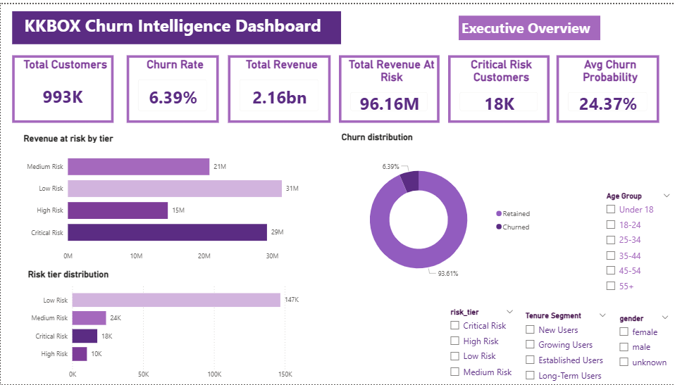
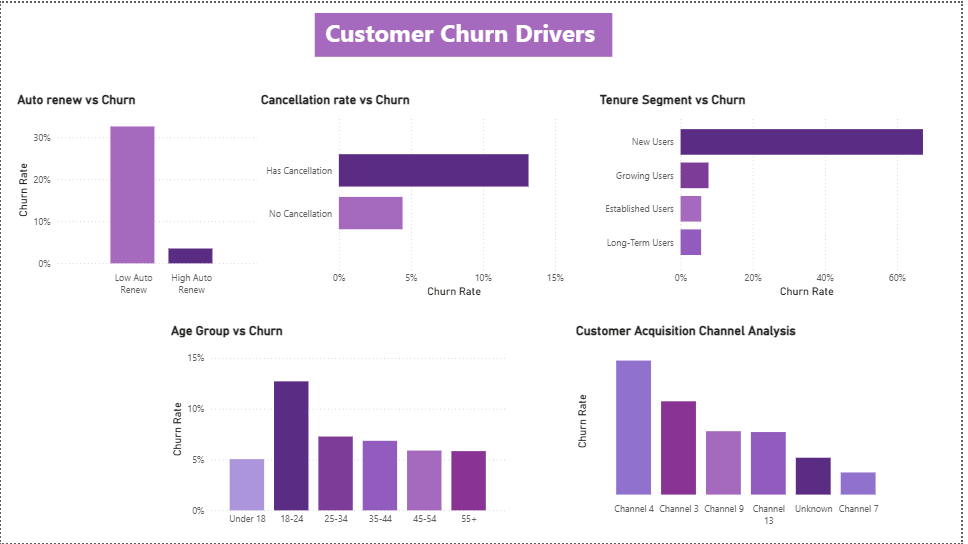
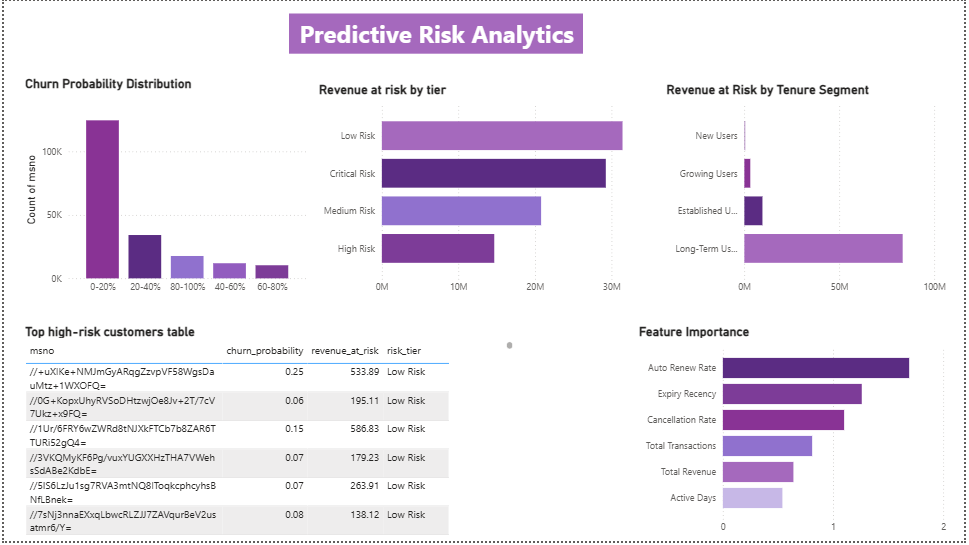

# Subscription Revenue Leakage & Churn Intelligence System

An end-to-end customer churn and revenue-risk analytics project built using **MySQL, Python, Statistical Analysis, Machine Learning, and Power BI** to investigate subscription churn behaviour, identify customer risk patterns, estimate revenue exposure, and support data-driven customer retention decisions.

---

## 1. Business Problem

Subscription-based businesses face several challenges that affect recurring revenue and customer retention:

- Customer churn and declining retention rates.
- Failed renewals and subscription cancellations.
- Low customer engagement and inactivity.
- Poor acquisition-channel performance.
- Limited visibility into high-risk customer segments.
- Revenue exposure associated with customers likely to churn.

Identifying customers who may churn is not sufficient on its own. Businesses also need to understand the behavioural factors associated with churn, quantify potential financial exposure, and prioritize retention efforts.

This project develops an analytical workflow to investigate these challenges using customer demographics, subscription transactions, renewal behaviour, and listening activity.

## 2. Project Objectives

The project addresses the following business questions:

1. What proportion of customers have churned?
2. Which customer behaviours are associated with higher churn rates?
3. How do auto-renewal and cancellation patterns differ across churn segments?
4. How does customer tenure influence retention behaviour?
5. Which customer age groups and acquisition channels exhibit higher churn rates?
6. Can customer churn probability be estimated using historical behavioural and transactional features?
7. How much historical transaction revenue is exposed to predicted churn risk?
8. Which customer segments should be prioritized for retention interventions?

## 3. Dataset Overview

**Dataset:** KKBOX Churn Prediction Dataset

**Source:** [Kaggle – KKBOX Churn Prediction Challenge](https://www.kaggle.com/competitions/kkbox-churn-prediction-challenge/data)

The project uses multiple datasets from the KKBOX subscription platform.

| Dataset | Description |
|---|---|
| Members | Customer demographics, age, gender, city, and registration information |
| Transactions | Subscription transactions, payment amounts, renewal and cancellation behaviour |
| User Activity | Listening behaviour and engagement metrics |
| Train Labels | Customer churn labels used for supervised learning |

### Key Data Attributes

**Customer information**
- Customer identifier
- Age
- Gender
- City
- Registration channel
- Registration date

**Subscription transactions**
- Transaction date
- Payment amount
- Subscription plan duration
- Auto-renewal indicator
- Cancellation indicator
- Membership expiry date

**User engagement**
- Total listening time
- Average listening time
- Active listening days
- Total plays
- Completion ratio

**Target variable**
- `is_churn`: Binary churn indicator.

The datasets were integrated to create a customer-level analytical dataset containing demographic, behavioural, transactional, and churn information.

---

## 4. Technology Stack

| Category | Technologies |
|---|---|
| Database | MySQL |
| Query Language | SQL |
| Programming | Python |
| Data Manipulation | Pandas, NumPy |
| Statistical Analysis | SciPy |
| Machine Learning | Scikit-learn, Imbalanced-learn |
| Predictive Model | Logistic Regression |
| Visualization | Matplotlib, Power BI |
| Development Environment | VS Code, Jupyter Notebook |
| Version Control | Git, GitHub |
| Large File Management | Git LFS |

---

## 5. Project Architecture & Workflow

The project follows a structured analytical workflow that combines relational data processing, statistical analysis, predictive modelling, and business intelligence reporting.

```text
          KKBOX DATASETS
                 |
                 v
          DATA INGESTION
                 |
                 v
             MySQL
                 |
                 v
       DATA VALIDATION
                 |
                 v
          DATA CLEANING
                 |
                 v
     SQL FEATURE ENGINEERING
                 |
                 v
       CUSTOMER CHURN BASE
                 |
          +------+------+
          |             |
          v             v
       PYTHON          SQL
          |             |
          v             v
    STATISTICAL       EXPLORATORY
     ANALYSIS          ANALYSIS
          |
          v
    MACHINE LEARNING
          |
          v
    CHURN PROBABILITY
          |
          v
    REVENUE-RISK ANALYSIS
          |
          v
     CSV DATA EXPORTS
          |
          v
       POWER BI
          |
          v
   BUSINESS INTELLIGENCE
```

### 5.1 Data Ingestion & SQL Pipeline

Raw datasets were loaded into MySQL to establish a relational analytical environment.

The data processing workflow involved:

- Loading customer and subscription datasets.
- Importing transaction records.
- Integrating user activity information.
- Validating customer identifiers and record counts.
- Preparing source tables for downstream analysis.

The primary datasets used in the SQL workflow include:

- `raw_members`
- `raw_train`
- `raw_transactions`
- `user_behavior_features`

### 5.2 Data Cleaning & Validation

Data validation and cleaning were performed to improve data consistency and analytical reliability.

Key operations included:

- Identifying missing and invalid values.
- Handling invalid age values.
- Standardizing gender categories.
- Converting transaction and membership expiry dates.
- Identifying duplicate customer records.
- Validating referential integrity across datasets.
- Identifying suspicious payment records.
- Validating transaction amounts and subscription dates.

The cleaned datasets were used for customer-level feature engineering.

### 5.3 SQL Feature Engineering

Customer-level transactional and subscription features were engineered using SQL aggregations, conditional logic, date functions, and grouping operations.

**Transactional features**
- Total transactions
- Total historical transaction revenue
- Average payment amount
- Minimum and maximum payment amounts
- Active transaction days

**Subscription features**
- Average subscription plan duration
- Membership tenure
- First and last transaction dates
- Membership expiry recency

**Renewal and cancellation features**
- Auto-renewal count
- Auto-renewal rate
- Cancellation count
- Cancellation rate

**Payment anomaly features**
- Suspicious payment count
- Suspicious payment rate

*Note: Auto-renewal rate must be calculated using the average of the binary renewal indicator, not its sum. The feature-engineering implementation should be corrected and downstream results regenerated before treating this metric as finalized.*

### 5.4 Customer Behaviour Feature Engineering

User activity information was aggregated into customer-level engagement metrics using Python and SQL-ready analytical datasets.

Features included:

- Average listening time.
- Total listening seconds.
- Average unique listening activity.
- Active listening days.
- Average completion ratio.
- Total plays.

These features provide behavioural indicators for investigating customer engagement and churn patterns.

### 5.5 Customer Churn Base Creation

A master analytical table named `churn_base` was created by integrating:

- Customer demographics.
- Transactional features.
- Subscription behaviour.
- Listening activity.
- Revenue metrics.
- Churn labels.

This table serves as the central analytical dataset for exploratory analysis, statistical testing, machine learning, and dashboard reporting.

---

## 6. Exploratory Data Analysis (EDA)

Exploratory data analysis was performed using SQL to understand customer behaviour, identify churn patterns, and investigate potential business risks.

### 6.1 Overall Customer Churn

- Overall churn distribution.
- Retained versus churned customers.
- Customer-level churn percentage.

### 6.2 Subscription Behaviour Analysis

- Auto-renewal behaviour versus churn.
- Cancellation behaviour versus churn.
- Renewal and cancellation patterns.
- Suspicious payment behaviour.

### 6.3 Customer Tenure Analysis

Customers were grouped into four tenure segments:

| Segment | Tenure |
|---|---|
| New Users | Less than 30 days |
| Growing Users | 30–179 days |
| Established Users | 180–364 days |
| Long-Term Users | 365 days or more |

Churn rates were compared across these customer lifecycle segments.

### 6.4 Demographic Analysis

- Churn by age group.
- Churn by gender.
- Customer distribution by registration channel.

### 6.5 Revenue & Engagement Analysis

- Average revenue by churn status.
- Transaction frequency versus churn.
- Listening engagement versus churn.
- Revenue concentration across customer segments.

---

## 7. Statistical Analysis

Statistical analysis was performed using Python, Pandas, NumPy, and SciPy.

The objective was to investigate distributions, identify behavioural differences, and evaluate associations between customer attributes and churn.

### 7.1 Distribution Analysis

Analysed the distributions of:

- Total revenue.
- Membership tenure.
- Average listening time.
- Active listening days.

Statistical measures included:

- Mean.
- Median.
- Skewness.
- Interquartile range (IQR).
- Outlier identification.

### 7.2 Conditional Probability Analysis

Estimated conditional churn probabilities for selected behavioural segments.

Examples:

- \(P(\text{Churn} \mid \text{Low Auto-Renew})\)
- \(P(\text{Churn} \mid \text{Low Activity})\)

These analyses helped compare churn prevalence across behavioural groups.

### 7.3 Hypothesis Testing

**Mann–Whitney U Test**

Objective: Compare membership tenure distributions between churned and retained customers.

- Null hypothesis: The membership tenure distributions are identical between the two groups.
- Alternative hypothesis: The membership tenure distributions differ between the two groups.

**Chi-Square Test of Independence**

Objective: Investigate the association between customer gender and churn status.

- Null hypothesis: Gender and churn status are independent.
- Alternative hypothesis: Gender and churn status are associated.

*Statistical test results should be interpreted using the actual test statistics, p-values, sample sizes, and assumptions. Statistical association does not establish causation.*

### 7.4 Correlation & Behavioural Analysis

Investigated relationships involving:

- Customer engagement.
- Subscription renewal behaviour.
- Transaction activity.
- Revenue.
- Customer tenure.

---

## 8. Machine Learning — Customer Churn Prediction

A Logistic Regression classifier was developed to estimate customer churn probability using engineered demographic, transactional, subscription, and behavioural features.

### 8.1 Feature Selection

Selected features included:

| Category | Features |
|---|---|
| Demographics | City, age, gender, registration channel |
| Listening Behaviour | Average listening time, total listening time, active days, total plays, completion ratio |
| Transactions | Total transactions, total revenue, average payment revenue |
| Subscription Behaviour | Cancellation rate, auto-renewal feature |
| Customer Lifecycle | Membership tenure, expiry recency |
| Payment Behaviour | Suspicious payment rate |

**Target variable:** `is_churn`

### 8.2 Model Development

The initial modelling workflow included:

1. Feature selection.
2. Categorical encoding.
3. Missing-value imputation.
4. Feature standardization.
5. Stratified train/test split.
6. Class imbalance handling using SMOTE.
7. Logistic Regression model training.
8. Churn probability prediction.
9. Model evaluation.

SMOTE was applied to the training partition to address class imbalance.

*Implementation improvement: The current scripts fit the imputer and scaler before the train/test split. These transformations must be fitted on training data only and then applied to the test data. Model metrics should be recalculated after correcting this preprocessing leakage.*

### 8.3 Model Evaluation

The initial implementation reported the following evaluation results:

| Evaluation Metric | Reported Score |
|---|---:|
| ROC-AUC | 0.9283 |
| Precision — Churn Class | 0.33 |
| Recall — Churn Class | 0.86 |
| F1-Score — Churn Class | 0.47 |

**Initial model interpretation**

- ROC-AUC measures the model's ability to discriminate between churn and non-churn customers.
- Recall of 0.86 indicates that approximately 86% of actual churn cases were identified at the selected classification threshold.
- Precision of 0.33 indicates that approximately 33% of customers classified as churners were actual churners.
- The F1-score reflects the balance between precision and recall.

The initial classification approach emphasizes identifying more potential churners, but this comes with a higher false-positive burden.

These are preliminary reported results, not independently validated final model performance.

### 8.4 Model Feature Importance

The model's standardized logistic regression coefficients were examined to identify features associated with its predictions.

The dashboard highlights:

- Auto-renewal behaviour.
- Expiry recency.
- Cancellation behaviour.
- Total transactions.
- Total revenue.
- Active days.

Coefficient magnitude indicates model-specific predictive association. It should not be interpreted as proof of causality.

---

## 9. Revenue-at-Risk Intelligence

The predictive modelling outputs were integrated with customer transaction information to estimate probability-weighted revenue exposure.

### 9.1 Revenue Exposure Calculation

For each scored customer:

\[
\text{Revenue at Risk}_i =
P(\text{Churn}_i) \times \text{Historical Revenue}_i
\]

Where:

- \(P(\text{Churn}_i)\) is the predicted churn probability.
- Historical Revenue is the customer's aggregated transaction revenue.

Total estimated exposure:

\[
\text{Total Revenue at Risk} =
\sum_{i=1}^{n}\text{Revenue at Risk}_i
\]

This is a probability-weighted historical transaction revenue proxy. It is not the same as monthly recurring revenue, forecasted future cash flow, or confirmed financial loss.

### 9.2 Customer Risk Segmentation

Customers were segmented using predicted churn probabilities.

| Risk Tier | Churn Probability |
|---|---:|
| Low Risk | Below 30% |
| Medium Risk | 30%–59.99% |
| High Risk | 60%–79.99% |
| Critical Risk | 80% or above |

### 9.3 Revenue Exposure Analysis

The analysis evaluates:

- Revenue exposure by risk tier.
- Customer distribution across risk segments.
- Revenue exposure by customer tenure.
- High-value customer exposure.
- Customer-level predicted churn probability.

### 9.4 Retention Prioritization

The analytical outputs can support retention teams in identifying:

- High-probability churn customers.
- High-value customers with elevated churn probability.
- Customer segments requiring renewal interventions.
- Behavioural groups suitable for targeted retention campaigns.

These are potential business actions supported by the analytical framework, not measured intervention outcomes.

---

## 10. Python Analytics & Automation Pipeline

Python scripts connect to MySQL, execute the modelling workflow, generate customer-level predictions, and export analytical outputs.

The scoring workflow includes:

1. Establishing a MySQL connection.
2. Loading the customer churn base.
3. Selecting model features.
4. Preparing the feature matrix.
5. Splitting the dataset into training and test partitions.
6. Applying SMOTE to training data.
7. Training the Logistic Regression model.
8. Generating churn probabilities.
9. Assigning customer risk tiers.
10. Calculating probability-weighted revenue exposure.
11. Exporting customer predictions and risk summaries.

### Generated Outputs

| Output | Description |
|---|---|
| `customer_risk_predictions.csv` | Customer-level churn predictions, risk tiers, and revenue exposure |
| `risk_tier_summary.csv` | Customer counts and revenue-risk summaries by risk tier |

The current Python automation script performs batch model scoring and CSV generation. It is not a scheduled production monitoring system.

---

## 11. Power BI Dashboard

The project includes a three-page interactive Power BI dashboard designed to communicate customer churn patterns, predictive risk, and financial exposure.

### Page 1 — Executive Overview



**Key KPIs displayed**

| KPI | Dashboard Value |
|---|---:|
| Total Customers | 993K |
| Churn Rate | 6.39% |
| Total Revenue | 2.16bn |
| Total Revenue at Risk | 96.16M |
| Critical Risk Customers | 18K |
| Average Churn Probability | 24.37% |

**Dashboard components**

- Customer and revenue KPI cards.
- Churn versus retained customer distribution.
- Revenue exposure by customer risk tier.
- Risk-tier customer distribution.
- Age-group filtering.
- Customer tenure filtering.
- Gender filtering.
- Risk-tier filtering.

**Business purpose:** Provide an executive-level overview of customer retention, churn exposure, and customer risk distribution.

**Population clarification:** The customer-level risk analysis is based on the approximately 20% holdout partition generated by the current modelling workflow, whereas the headline customer count represents the full dataset. The two populations must be labelled separately in the dashboard.

The average predicted churn probability is also distinct from the observed churn rate and should be interpreted using its scoring population.

### Page 2 — Customer Churn Drivers



**Dashboard components**

- Auto-renewal behaviour versus churn.
- Cancellation behaviour versus churn.
- Customer tenure segment versus churn.
- Age-group churn analysis.
- Customer acquisition channel analysis.

**Business purpose:** Identify behavioural and demographic segments with different observed churn rates.

The dashboard supports investigation of subscription renewal patterns, cancellation behaviour, customer lifecycle stages, and acquisition-channel performance.

### Page 3 — Predictive Risk Analytics



**Dashboard components**

- Predicted churn probability distribution.
- Revenue exposure by risk tier.
- Revenue exposure by tenure segment.
- Customer-level risk analysis.
- Logistic Regression coefficient-based feature importance.

**Business purpose:** Translate model predictions into customer risk segments and estimated financial exposure.

*The customer-level table should be filtered to the intended high-risk tiers before being labelled as a high-risk customer list. Customer identifiers should be masked in the public dashboard.*

---

## 12. Key Analytical Findings

The initial analysis and dashboard highlight the following patterns:

1. **Auto-renewal behaviour:** Customers in the low auto-renewal segment exhibited higher observed churn rates than those in the high auto-renewal segment.
2. **Cancellation behaviour:** Customers with cancellation activity showed higher churn rates than customers without cancellation activity.
3. **Customer tenure:** New users exhibited substantially higher churn rates than longer-tenure customer segments.
4. **Demographic patterns:** Churn rates varied across age groups and acquisition channels.
5. **Customer risk concentration:** Predicted customer risk was distributed across low, medium, high, and critical risk tiers.
6. **Revenue exposure:** Probability-weighted historical revenue exposure was estimated at approximately 96.16M in the dashboard's dataset monetary units.

These findings describe the analysed dataset and model outputs. They should not be interpreted as causal effects or verified business outcomes.

---

## 13. Repository Structure

```text
subscription-revenue-leakage-churn-intelligence-system/
│
├── 01_Dataset/
│
├── 02_SQL/
│   ├── 01_data_validation.sql
│   ├── 02_data_cleaning.sql
│   ├── 03_transaction_feature_engineering.sql
│   ├── 04_churn_base.sql
│   └── 05_exploratory_data_analysis.sql
│
├── 03_Python/
│   ├── 06_statistical_analysis.py
│   ├── 07_churn_prediction_model.py
│   ├── 08_revenue_at_risk_analysis.py
│   ├── 09_automation_pipeline.py
│   ├── db_connection.py
│   ├── execute_sql.py
│   └── output/
│
├── 04_PowerBI/
│   └── finalized_dashboard.pbix
│
├── 05_Images/
│   ├── Page-1.png
│   ├── Page-2.png
│   └── Page-3.png
│
├── .gitattributes
└── README.md
```

---

## 14. How to Run the Project

### Prerequisites

- Python 3.x
- MySQL Server
- MySQL Workbench or another MySQL client
- Power BI Desktop
- Git
- Git LFS

### Step 1 — Clone the Repository

```bash
git lfs install

git clone https://github.com/Priya200227/subscription-revenue-leakage-churn-intelligence-system.git

cd subscription-revenue-leakage-churn-intelligence-system
```

### Step 2 — Install Python Dependencies

Install the required packages:

```bash
pip install pandas numpy scipy scikit-learn imbalanced-learn matplotlib mysql-connector-python
```

### Step 3 — Configure MySQL

Create the required database and load the source datasets into the corresponding tables.

Configure the MySQL connection in:

```text
03_Python/db_connection.py
```

Use your own local credentials. Do not commit database passwords or other secrets to the public repository.

### Step 4 — Execute SQL Scripts

Execute the SQL scripts in MySQL Workbench in the appropriate order:

```text
02_SQL/01_data_validation.sql
02_SQL/02_data_cleaning.sql
02_SQL/03_transaction_feature_engineering.sql
02_SQL/04_churn_base.sql
02_SQL/05_exploratory_data_analysis.sql
```

Ensure that the source tables, including the prepared user activity feature table, are available before executing the dependent scripts.

### Step 5 — Run Statistical Analysis

From the Python directory:

```bash
cd 03_Python

python 06_statistical_analysis.py
```

### Step 6 — Train and Evaluate the Churn Model

```bash
python 07_churn_prediction_model.py
```

Review the model evaluation output and verify the corrected preprocessing workflow before treating its metrics as final.

### Step 7 — Execute Revenue-Risk Analysis

```bash
python 08_revenue_at_risk_analysis.py
```

### Step 8 — Run the Batch Analytics Pipeline

```bash
python 09_automation_pipeline.py
```

The pipeline generates customer-level prediction and risk-summary CSV outputs in the Python output directory.

### Step 9 — Open the Power BI Dashboard

Open:

```text
04_PowerBI/finalized_dashboard.pbix
```

Connect or update the data source paths as required and refresh the dashboard using the appropriate analytical outputs.

---

## 15. Large File Management

The Power BI dashboard file is tracked using Git Large File Storage (Git LFS).

Install Git LFS before cloning the repository to ensure large tracked files are downloaded correctly.

```bash
git lfs install
git lfs pull
```

---

## 16. Limitations & Future Improvements

### Current Limitations

- The initial model preprocessing workflow requires correction to prevent test-set information leakage.
- Auto-renewal rate calculation requires correction and downstream feature regeneration.
- The current risk-scoring outputs represent a holdout subset rather than the entire customer population.
- Probability-weighted historical revenue is a proxy for financial exposure, not a direct estimate of future recurring revenue loss.
- Logistic Regression feature coefficients describe model associations, not causal relationships.
- The current model requires further validation, including calibration and threshold analysis.
- Customer-level high-risk reporting requires corrected risk filtering and ranking.

### Future Improvements

- Implement leakage-safe preprocessing using Scikit-learn and Imbalanced-learn pipelines.
- Evaluate alternative classification models and compare performance.
- Perform cross-validation and probability calibration.
- Optimize classification thresholds using business costs and retention capacity.
- Develop a more robust customer lifetime value and recurring revenue exposure framework.
- Score the full eligible customer population after model validation.
- Introduce automated model monitoring and prediction tracking.
- Add explainability techniques such as SHAP for deeper model interpretation.
- Improve dashboard monitoring with consistently defined KPIs and customer populations.

---

## 17. Project Outcomes

This project demonstrates practical experience across multiple stages of an analytics workflow:

- Relational data integration and SQL feature engineering.
- Data cleaning, validation, and exploratory analysis.
- Customer behavioural and transactional analytics.
- Statistical distribution analysis and hypothesis testing.
- Predictive modelling using Logistic Regression.
- Imbalanced classification using SMOTE.
- Customer churn probability estimation.
- Probability-weighted revenue exposure analysis.
- Python-based batch analytics and CSV reporting.
- Executive-level business intelligence dashboard development.

The project demonstrates how SQL, Python, statistics, machine learning, and Power BI can be combined to investigate subscription churn and translate customer-level analysis into actionable retention intelligence.

---

## Author

**Jyothi Priya**

Data Analyst | SQL | Python | Statistics | Power BI

- [GitHub](https://github.com/Priya200227)
- [LinkedIn](https://www.linkedin.com/in/jyothi-priya-554279247/)
- [Portfolio](https://priya200227.github.io/)
